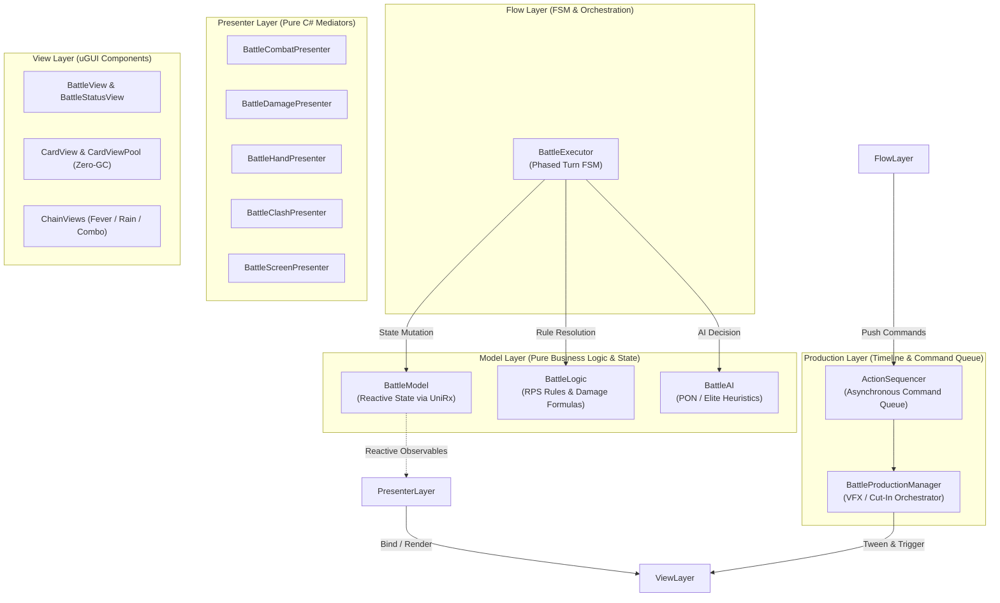

# Turn-Based Card Battle Core Framework

A modular, reactive, and data-driven turn-based card battle framework built in **Unity (C#)**.  
Engineered with clean layered architecture principles (**Model - Flow - Presenter - Production - View**), reactive state decoupling via **UniRx**, zero-allocation object pooling, and a dedicated **Action Sequencer** for fluid presentation.

---

## 🏗️ Layered Architecture & Data Flow



---

## 🌟 Key Engineering Highlights

### 1. 5-Tier Decoupled Domain Architecture
- **Model**: Pure data models, reactive state properties, and deterministic card battle logic with zero Unity Engine dependencies.
- **Flow**: Finite State Machine controlling transactional turn progression:  
  `Setup` ➔ `RoundStart` ➔ `Command` ➔ `Process` ➔ `RoundEnd` ➔ `Result`.
- **Presenter**: Lightweight C# mediator classes bridging Models and Views without monolithic view scripts.
- **Production**: Isolated asynchronous command sequencer managing particle effects, cut-ins, and timeline animations.
- **View**: Domain-organized UI components (`Card`, `Chain`, `Speak`, `Battle`, `Common`).

### 2. Zero-GC UI Card Pooling System (`CardViewPool`)
- Eliminates runtime Garbage Collection spikes by recycling card UI instances through an expandable pool.
- Seamlessly integrated across Hand containers and Clash layout groups.

### 3. Pure Domain Automated Unit Testing (`BattleRuleTests`)
- **21/21 Domain Rules Verified**: Full combinatorial coverage of Rock-Paper-Scissors resolution (9 rules), Fool counter rules (7 rules), and Special Skill trigger conditions (5 rules).
- Includes one-click test execution directly within Unity Inspector custom editors and top-level menu (`Tools > Run Battle Domain Tests`).

### 4. Reactive State Management via UniRx
- HP, Special Gauges, Hand cards, and Fever states encapsulated in `ReactiveProperty<T>` and `ReactiveCollection<T>`.
- Views reactively bind to state transitions, eliminating polling in `Update()` loops.

### 5. Pluggable Asset Provider & IP-Neutral Demo Pipeline
- `IAssetProvider` abstracts resource resolution (`Resources.Load`), enabling runtime fallback and asset provider swapping.
- Includes in-editor **`DemoTableGenerator`** (`Tools > Portfolio > Generate Demo XML Tables`), extracting pure gameplay data while stripping commercial/third-party IP into neutral assets.

---

## 🎮 Quick Start & Running the Demo

1. **Environment Requirements**:
   - **Unity Editor**: `2021.3.1f1` (LTS) or higher
   - **Platform**: PC Standalone (Windows / macOS)

2. **Opening the Demo**:
   - Clone this repository and open the project root in Unity Hub.
   - Open [Assets/Demo/Scenes/DemoBattleScene.unity](file:///c:/dev/Unity/ProjectH/Assets/Demo/Scenes/DemoBattleScene.unity).
   - Press **Play** in the Unity Editor.

3. **Playing the Battle Loop**:
   - Select Rock, Paper, or Scissors cards from your hand.
   - Click **Submit** to resolve clashes against the AI opponent.
   - Gain Special Gauge from clashes to unleash character abilities (Emergency Heal / Berserk Strike).
   - Win by reducing opponent HP to 0 or having higher HP at round limit.

---

## 📂 Repository Structure

```
Assets/
├── Demo/                             # Self-contained standalone battle demo
│   ├── Editor/                       # IP-Neutral Demo Table Generator
│   ├── Prefabs/                      # Card and UI prefabs
│   ├── Resources/
│   │   ├── Sprites/                  # Minimalist arena, silhouettes & RPS icons
│   │   └── XMLData/                  # Clean gameplay data tables
│   └── Scenes/DemoBattleScene.unity  # Runnable standalone demo scene
├── Plugins/
│   ├── Demigiant/                    # DOTween animation engine
│   └── UniRx/                        # Reactive Extensions for Unity
└── Scripts/Core/
    ├── Common/                       # Global game & audio constants
    ├── Flow/                         # Phased FSM turn executors
    ├── Model/                        # Pure rules, damage formulas & reactive state
    ├── Presenter/                    # Mediator presenters (Combat, Hand, Clash, Screen)
    ├── Production/                   # ActionSequencer & VFX orchestration
    ├── Tables/                       # Data-driven XML parsers & loaders
    ├── Tests/                        # Pure domain unit tests (21/21 rules)
    ├── Utils/                        # Zero-GC CardViewPool, AssetProvider & DevBootstrapper
    └── View/                         # Domain-segregated UI (Battle, Card, Chain, Speak, Common)
```

---

## 📄 License & Attribution

This repository is maintained as a technical portfolio demonstrating gameplay architecture, reactive programming, and performance optimization.  
All framework architectures, combat logic, and pooling systems authored by the repository owner.
