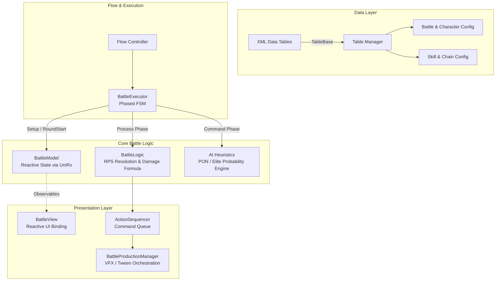

# Turn-Based Card Battle Core Framework

A modular, reactive, and data-driven turn-based card battle framework built in **Unity (C#)**.  
Designed with clean architecture principles, state decoupling via **UniRx**, and an asynchronous **Command-Pattern Action Sequencer** for fluid presentation.

---

## 🏗️ Architectural Overview



### Key Engineering Highlights

1. **Reactive State Management (UniRx)**
   - Character HP, Special Skill Gauges, Fever states, and card collections are encapsulated as `ReactiveProperty<T>` and `ReactiveCollection<T>`.
   - UI views reactively subscribe to state transitions without tight coupling to game loop execution.

2. **Data-Driven Pipeline**
   - Battle definitions, character parameters, skill effects, chain bonuses, and localized strings are decoupled into XML tables.
   - Loaded and indexed dynamically through a generic `TableManager` and `TableBase<T>` loader.

3. **Phased Finite State Machine (FSM)**
   - `BattleExecutor` strictly controls turn flow:  
     `Setup` ➔ `RoundStart` ➔ `Command` ➔ `Process` ➔ `RoundEnd` ➔ `Result`
   - Prevents race conditions and guarantees transactional turn processing.

4. **Heuristic AI Engine**
   - Implements multi-tier difficulty profiles (`PON` casual vs. `Elite` tactical) using runtime probability distributions defined in data tables.
   - Evaluates player deck tendencies, hand counters, and special skill thresholds.

5. **Asynchronous Command Sequencer**
   - Decouples visual tween animations (DOTween) and particle effects from underlying game rules.
   - Chains card clashes, damage floaters, fever transitions, and camera shakes into sequential, interruptible execution queues.

6. **Pluggable Asset Provider (`IAssetProvider`)**
   - Abstracted resource loading layer allows runtime swapping of asset delivery systems (e.g., Resources, Addressables, or mock providers for automated testing).

---

## 🎮 Quick Start & Running the Demo

1. **Environment Requirements**:
   - **Unity Editor**: `2021.3.1f1` (LTS) or higher
   - **Render Pipeline**: Universal Render Pipeline (URP) / Built-in compatible

2. **Opening the Demo**:
   - Clone this repository and open the project root in Unity Hub.
   - Navigate to `Assets/Demo/Scenes/DemoBattleScene.unity` and open it.
   - Press **Play** in the Unity Editor.

3. **Playing the Battle Loop**:
   - Select one or more cards from your hand (Rock / Paper / Scissors).
   - Press **Submit** to clash cards against the AI opponent.
   - Fill your Special Skill gauge through clashes to unleash powerful character abilities.
   - Win by reducing the opponent's HP to 0 or having higher HP when the round limit is reached.

---

## 📂 Directory Structure

```
Assets/
├── Demo/                  # Self-contained runnable battle demo
│   ├── Prefabs/           # Clean UI card prefabs
│   ├── Resources/XMLData/ # Pure gameplay data tables (zero external IP)
│   ├── Scenes/            # DemoBattleScene.unity
│   └── Sprites/           # RPS icons and panel artwork
├── Plugins/
│   ├── Demigiant/         # DOTween & DOTween Pro
│   └── UniRx/             # Reactive Extensions for Unity
└── Scripts/
    └── Core/
        ├── Audio/         # Audio management interfaces
        ├── Battle/        # Pure business logic & reactive models
        ├── Common/        # Game constants & shared definitions
        ├── Flow/          # Turn flow executors & FSM controllers
        ├── Tables/        # XML data parsing & table managers
        ├── Tutorial/      # Dynamic tutorial narrator & overlay hooks
        ├── Utils/         # Asset providers, singletons & dev bootstrapper
        └── View/          # Action sequencer, card views & production managers
```

---

## 📄 License & Attribution

This project is released as a portfolio and framework demonstration.  
All gameplay systems, reactive architectures, and logic implementation authored by the repository owner.
